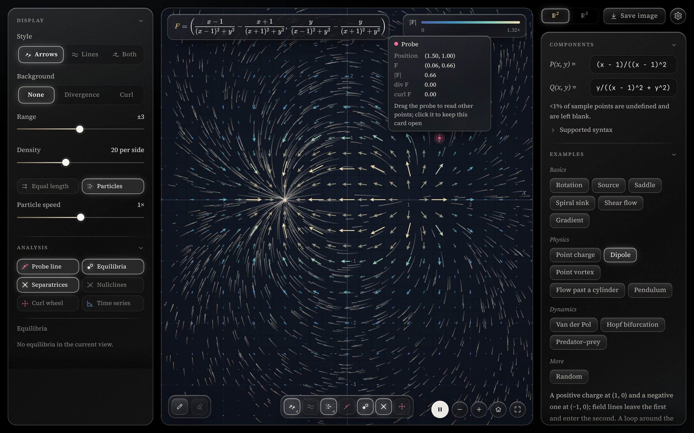
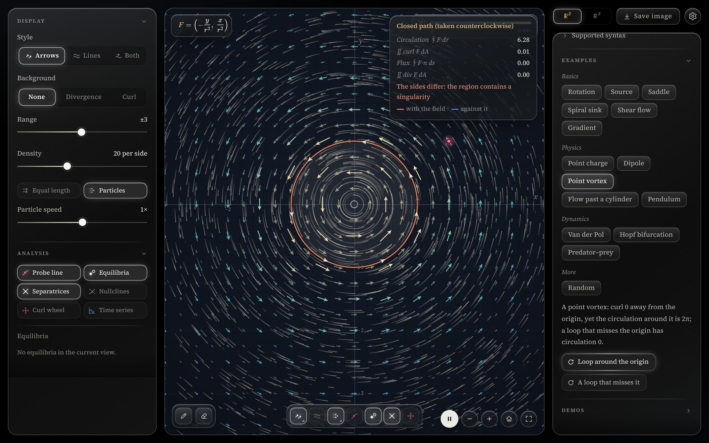
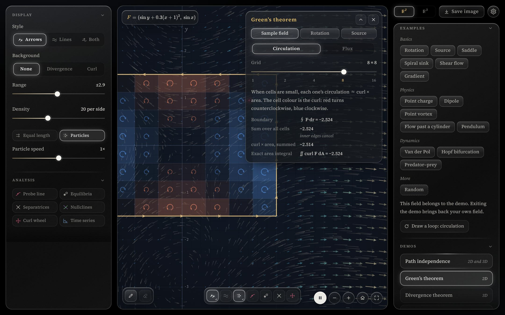
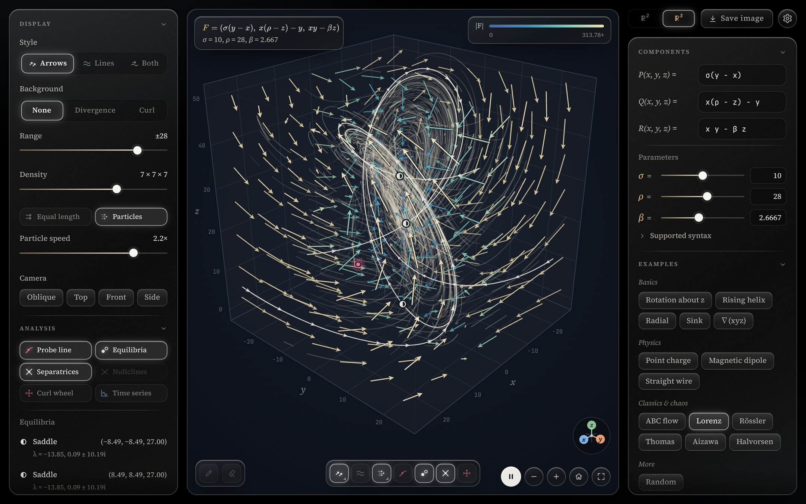

# Vector Field Sketchpad

**English** · [中文](README.zh-CN.md)

An interactive vector field plotter that runs in the browser. Type the components of a 2D or 3D field and watch arrows, streamlines and particles move through it. Divergence, curl, circulation and flux are computed as you go.

### ▶ [Open it in your browser](https://jiajieou-hub.github.io/vector-field/)

There's nothing to install and no account to make. It works on desktop and on phones.



## Who it's for

- **Students** of multivariable or vector calculus, differential equations, electromagnetism or fluid mechanics who want to *see* divergence, curl, line integrals, Green's / Stokes' / Gauss's theorems and phase portraits.
- **Teachers** who want a live demo to project in class. Each example is a link you can share, such as [`#van-der-pol`](https://jiajieou-hub.github.io/vector-field/#van-der-pol).
- **Anyone curious** about what a field such as `(sin y, sin x)` or the Lorenz system looks like.

## Features

**Plot any field**
- 2D fields **F**(x, y) = (P, Q) and 3D fields **F**(x, y, z) = (P, Q, R), from formulas you type.
- Arrows are coloured by magnitude and can be drawn at equal length so only direction shows. You can also draw evenly spaced streamlines, or both.
- Flowing particles have adjustable speed and density.
- A divergence or curl heat-map can be shown behind the field (curl in 2D only).
- Any free letter such as `a`, `k`, `μ` or `σ` becomes a **parameter with its own slider**, so you can drag it and watch the field change.

**Probe and analyse**
- Drag the red **probe** to read **F**, |**F**|, div **F** and curl **F** at any point.
- Draw the **streamline through the probe**, put a **curl paddle wheel** on it, or plot the solution **over time** (x(t), y(t), …) starting from it.
- **Equilibria** are found automatically and classified as node, focus, saddle or centre, with their eigenvalues.
- You can also show **saddle separatrices** and **nullclines** (P = 0 and Q = 0).

**Line integrals and the big theorems (2D)**
- Draw a path to get the **work** ∫**F**·d**r**. Close the loop to get the **circulation** ∮**F**·d**r** and the **flux** ∮**F**·**n** ds.
- Both are checked against the area integrals of curl and divergence (Green's theorem). The page warns you when the loop encloses a singularity, as it does for a point vortex.



**Step-by-step demos**

| Demo | Dimensions | What it shows |
|---|---|---|
| Path independence | 2D and 3D | Three different paths from A to B. They agree exactly when the field is conservative. |
| Green's theorem | 2D | Subdivide a region into cells and watch the inner edges cancel, in both the circulation and the flux form. |
| Divergence theorem | 3D | Split a cube into small cubes and watch the shared faces cancel. |
| Stokes' theorem | 3D | Patches on a surface, its boundary curve, and why the result doesn't depend on the surface. |

The Green, Gauss and Stokes demos have a play bar: pause, drag through the animation, slow it down to 0.1×, loop it, or have it stop at the gold mark just before the arrows cancel.



**3D**
- Rotate, zoom and switch the camera between oblique, top, front and side views.
- Includes the classic chaotic attractors: Lorenz, Rössler, Thomas, Aizawa and Halvorsen.



**Everything else**
- **Share what you see.** The address bar always holds the current field, parameters and view. Copy the link and anyone who opens it sees the same thing.
- **Save image** exports the plot as a PNG with the formula on it.
- Full-screen mode, keyboard shortcuts and touch gestures.
- The interface is available in **English and 中文**. Switch languages in Settings (⚙).

## Built-in examples

Click a name to open it directly.

| | 2D | 3D |
|---|---|---|
| **Basics** | [Rotation](https://jiajieou-hub.github.io/vector-field/#rotation) · [Source](https://jiajieou-hub.github.io/vector-field/#source) · [Saddle](https://jiajieou-hub.github.io/vector-field/#saddle) · [Spiral sink](https://jiajieou-hub.github.io/vector-field/#spiral-sink) · [Shear flow](https://jiajieou-hub.github.io/vector-field/#shear) · [Gradient](https://jiajieou-hub.github.io/vector-field/#gradient) | [Rotation about z](https://jiajieou-hub.github.io/vector-field/#rotation-z) · [Rising helix](https://jiajieou-hub.github.io/vector-field/#helix) · [Radial](https://jiajieou-hub.github.io/vector-field/#radial) · [Sink](https://jiajieou-hub.github.io/vector-field/#sink) · [∇(xyz)](https://jiajieou-hub.github.io/vector-field/#grad-xyz) |
| **Physics** | [Point charge](https://jiajieou-hub.github.io/vector-field/#point-charge) · [Point vortex](https://jiajieou-hub.github.io/vector-field/#vortex) · [Dipole](https://jiajieou-hub.github.io/vector-field/#dipole) · [Flow past a cylinder](https://jiajieou-hub.github.io/vector-field/#cylinder) · [Pendulum](https://jiajieou-hub.github.io/vector-field/#pendulum) | [Point charge](https://jiajieou-hub.github.io/vector-field/#charge-3d) · [Magnetic dipole](https://jiajieou-hub.github.io/vector-field/#magnetic-dipole) · [Straight wire](https://jiajieou-hub.github.io/vector-field/#wire) |
| **Dynamics / chaos** | [Van der Pol](https://jiajieou-hub.github.io/vector-field/#van-der-pol) · [Hopf bifurcation](https://jiajieou-hub.github.io/vector-field/#hopf) · [Predator–prey](https://jiajieou-hub.github.io/vector-field/#predator-prey) | [ABC flow](https://jiajieou-hub.github.io/vector-field/#abc) · [Lorenz](https://jiajieou-hub.github.io/vector-field/#lorenz) · [Rössler](https://jiajieou-hub.github.io/vector-field/#rossler) · [Thomas](https://jiajieou-hub.github.io/vector-field/#thomas) · [Aizawa](https://jiajieou-hub.github.io/vector-field/#aizawa) · [Halvorsen](https://jiajieou-hub.github.io/vector-field/#halvorsen) |

Every example comes with a short explanation, and most have one-click actions, such as "Loop around the origin" or "Show separatrices". There's also a **Random** button that builds a new field each time.

## Typing a field

The input is forgiving. Write a formula the way you'd write it on paper.

| You can type | For example |
|---|---|
| Operators `+ - * / ^`, implicit multiplication | `2x`, `xy`, `sinx`, `x(1 - y)` |
| Powers, absolute value, scientific notation | `x^2`, `x²`, `sin^2 x`, `\|x\|`, `1e-3` |
| Functions | `sin cos tan sec csc cot`, `asin acos atan`, `sinh cosh tanh`, `exp ln lg log2 sqrt cbrt abs sign floor ceil`, `atan2(y, x)`, `pow min max hypot` |
| Constants and polar helpers | `pi`, `e`, `r` (distance to the origin), `θ` / `theta` (polar angle) |
| Parameters, each with a slider | `a b c d k m n s t u v w` and `α β γ δ ε λ μ ρ σ τ ω` |
| LaTeX | `\frac{x}{x^2+y^2}`, `\sqrt[3]{x}`, `e^{-x^2}`, `\log_2 x` |
| A whole vector at once (press Enter to split it) | `(-y, x)` or `\begin{pmatrix}-y\\x\end{pmatrix}` |

`ln` and `log` are the natural log and `lg` is base 10. If something can't be read, the error message says what is wrong and, for a mistyped name, suggests the one you probably meant ("Did you mean sin?").

## Controls

| Action | Mouse / keyboard | Touch |
|---|---|---|
| Pan (rotate in 3D) | Drag empty space · <kbd>Shift</kbd> + arrow keys | Drag · two-finger swipe |
| Zoom | Scroll wheel · <kbd>+</kbd> / <kbd>−</kbd> | Pinch |
| Move the probe | Drag the red dot · arrow keys | Drag the red dot |
| Draw a streamline or path (2D) | <kbd>P</kbd>, then click for a streamline or drag for a path | Draw-path button, then tap or drag |
| Clear streamlines and path | <kbd>Delete</kbd> | Clear button |
| Play / pause a theorem demo | <kbd>Space</kbd> (click the canvas first) | Play button in the demo card |
| Reset the view | <kbd>0</kbd> | Home button |
| Full screen | <kbd>F</kbd> | Full-screen button |
| Show all shortcuts | <kbd>?</kbd> | Settings (⚙) → Shortcuts |

## Running it locally

The whole app is a single self-contained file, [`index.html`](index.html), with no build step and no dependencies to install.

```bash
git clone https://github.com/jiajieou-hub/vector-field.git
```

```bash
cd vector-field
```

```bash
python3 -m http.server 8000
```

Then open <http://localhost:8000>. Opening `index.html` directly also works.

You need a modern browser with WebGL. Fonts come from Google Fonts and formula typesetting from KaTeX (via jsDelivr). Offline, everything still works, but formulas show as plain text.

<details>
<summary>How it works (for the curious)</summary>

- Formulas are parsed by a hand-written parser (with LaTeX support) and compiled to JavaScript functions. Derivatives for divergence, curl and the Jacobian are taken numerically.
- Arrows, particles and 3D scenes are drawn with WebGL 2. The quality adapts automatically to keep the frame rate smooth.
- Streamlines are integrated with RK4. The evenly spaced streamline plot follows the Jobard–Lefer approach.
- Nullclines use marching squares. Equilibria are found with Newton's method and classified from the eigenvalues of the Jacobian. Separatrices are integrated along the saddle's eigenvectors.
- The current field is stored in the URL hash, so every view is a shareable link.

</details>

## Privacy

On the GitHub Pages site, the page counts visits and image saves anonymously with [GoatCounter](https://www.goatcounter.com/). It sets no cookies and collects no personal data. To stop counting your own visits, open the page once with `#stats-off` at the end of the address. Use `#stats-on` to undo this. Nothing is counted when you run the page locally.

## License

[MIT](LICENSE). You are free to use, modify and share it, including in teaching materials, as long as the copyright notice is kept.

## Feedback

Found a bug or have an idea? [Open an issue](https://github.com/jiajieou-hub/vector-field/issues), or email <jiajie_ou@berkeley.edu>. The address is also under Settings (⚙) → Contact in the app.

Made by Jacky, with Claude.
