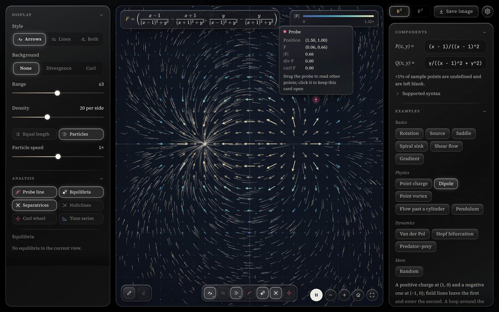
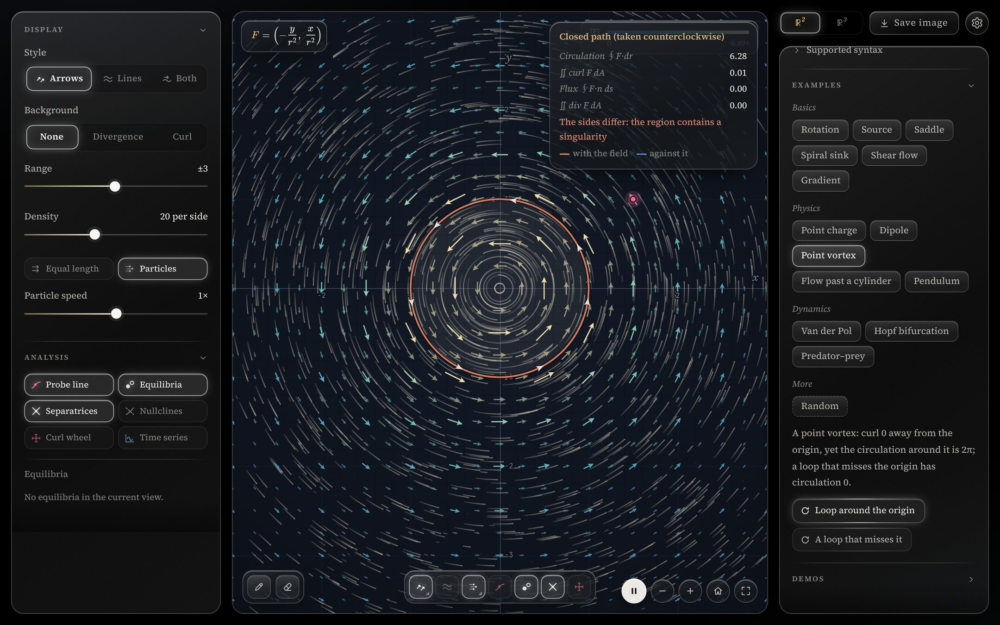
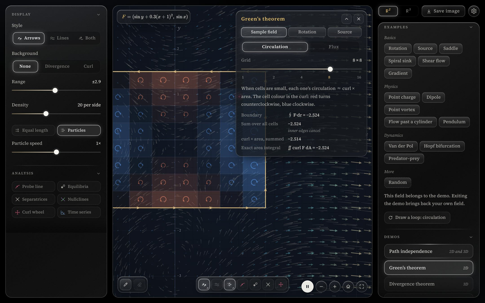
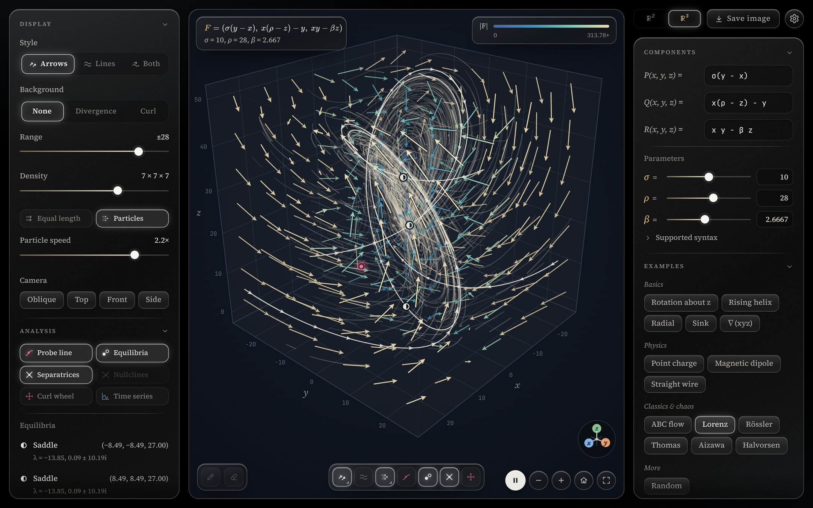

# 向量场画板 Vector Field Sketchpad

[English](README.md) · **中文**

一个在浏览器里运行的交互式向量场画板：输入二维或三维向量场的分量，就能看到箭头、流线和粒子在场里怎么走，并且当场算出散度、旋度、环量和通量。

### ▶ [直接在浏览器里打开](https://jiajieou-hub.github.io/vector-field/)

不用安装，不用注册，电脑和手机都能用。界面默认是英文，可以在 设置（⚙）→ 语言 里切换成中文。



## 适合谁

- **学生**：学多元微积分、向量分析、常微分方程、电磁学或流体力学时，想亲眼*看到*散度、旋度、曲线积分、格林、斯托克斯和高斯公式，以及相图。
- **老师**：上课时投屏现场演示。每个例子都有自己的链接，可以直接发给学生，比如 [`#van-der-pol`](https://jiajieou-hub.github.io/vector-field/#van-der-pol)。
- **好奇的人**：想看看 `(sin y, sin x)` 或洛伦兹系统长什么样。

## 功能

**画任意向量场**
- 二维 **F**(x, y) = (P, Q) 和三维 **F**(x, y, z) = (P, Q, R)，分量随便写式子。
- 画法可以选箭头、均匀铺开的流线，或两者都画。箭头的颜色表示大小，也可以设成箭头等长，只看方向。
- 流动粒子的速度和密度都可以调。
- 背景可以显示散度或旋度着色（旋度只在二维）。
- 式子里没定义的字母，如 `a`、`k`、`μ`、`σ`，会自动变成**参数**，各带一个滑块，拖动就能看场怎么变。

**探针和分析**
- 拖动红色**探针**，读出任意一点的 **F**、|**F**|、散度和旋度。
- 可以画**过探针的流线**，在探针上放一个**旋度小风车**，或者从探针出发画**时间曲线**（x(t)、y(t)……）。
- 自动找出**平衡点**，判断是结点、焦点、鞍点还是中心，并列出特征值。
- 还能显示**鞍点分界线**和**零等倾线**（P = 0、Q = 0）。

**曲线积分和几大公式（二维）**
- 画一条路径，算出沿路径的**功** ∫**F**·d**r**；首尾接上，再算出**环量** ∮**F**·d**r** 和**通量** ∮**F**·**n** ds。
- 结果会和旋度、散度的面积分对照（格林公式）。区域里包着奇点时（比如点涡）会特别提示。



**分步演示**

| 演示 | 维度 | 讲什么 |
|---|---|---|
| 曲线积分与路径无关 | 二维和三维 | 从 A 到 B 的三条不同路径：只有保守场时三个积分才一样 |
| 格林公式 | 二维 | 把区域切成小格，看内部的边怎样两两抵消（环量和通量两种形式） |
| 高斯公式 | 三维 | 把立方体切成小立方体，看公共面怎样抵消 |
| 斯托克斯公式 | 三维 | 曲面切成小块、边界曲线，以及为什么换一个曲面结果不变 |

格林、高斯、斯托克斯三个演示带播放条：可以暂停、拖动进度、放慢到 0.1×、循环播放，或者让它停在箭头即将抵消前的金色标记处。



**三维**
- 可以旋转、缩放，并在斜视、俯视、正视、侧视之间切换视角。
- 内置经典混沌吸引子：洛伦兹、Rössler、Thomas、Aizawa、Halvorsen。



**其他**
- **分享当前画面**：地址栏里一直保存着当前的场、参数和视图。把链接发给别人，对方打开看到的就是同一个画面。
- **保存图片**：把画面存成 PNG，图上带着式子。
- 支持全屏、键盘快捷键和触屏手势。
- **中文和英文**界面，在 设置（⚙）里切换。

## 内置例子

点名字可以直接打开。

| | 二维 | 三维 |
|---|---|---|
| **基础** | [旋转](https://jiajieou-hub.github.io/vector-field/#rotation) · [源](https://jiajieou-hub.github.io/vector-field/#source) · [鞍点](https://jiajieou-hub.github.io/vector-field/#saddle) · [螺旋汇](https://jiajieou-hub.github.io/vector-field/#spiral-sink) · [剪切流](https://jiajieou-hub.github.io/vector-field/#shear) · [梯度场](https://jiajieou-hub.github.io/vector-field/#gradient) | [绕 z 轴旋转](https://jiajieou-hub.github.io/vector-field/#rotation-z) · [螺旋上升](https://jiajieou-hub.github.io/vector-field/#helix) · [径向](https://jiajieou-hub.github.io/vector-field/#radial) · [汇](https://jiajieou-hub.github.io/vector-field/#sink) · [∇(xyz)](https://jiajieou-hub.github.io/vector-field/#grad-xyz) |
| **物理** | [点电荷](https://jiajieou-hub.github.io/vector-field/#point-charge) · [点涡](https://jiajieou-hub.github.io/vector-field/#vortex) · [偶极子](https://jiajieou-hub.github.io/vector-field/#dipole) · [绕圆柱流动](https://jiajieou-hub.github.io/vector-field/#cylinder) · [单摆](https://jiajieou-hub.github.io/vector-field/#pendulum) | [点电荷](https://jiajieou-hub.github.io/vector-field/#charge-3d) · [磁偶极子](https://jiajieou-hub.github.io/vector-field/#magnetic-dipole) · [直导线的磁场](https://jiajieou-hub.github.io/vector-field/#wire) |
| **动力系统 / 混沌** | [范德波尔](https://jiajieou-hub.github.io/vector-field/#van-der-pol) · [霍普夫分岔](https://jiajieou-hub.github.io/vector-field/#hopf) · [捕食者与猎物](https://jiajieou-hub.github.io/vector-field/#predator-prey) | [ABC 流](https://jiajieou-hub.github.io/vector-field/#abc) · [洛伦兹](https://jiajieou-hub.github.io/vector-field/#lorenz) · [Rössler](https://jiajieou-hub.github.io/vector-field/#rossler) · [Thomas](https://jiajieou-hub.github.io/vector-field/#thomas) · [Aizawa](https://jiajieou-hub.github.io/vector-field/#aizawa) · [Halvorsen](https://jiajieou-hub.github.io/vector-field/#halvorsen) |

每个例子都附有简短说明，大多还带一键操作，比如「绕原点画一圈」「显示分界线」。另外有一个**随机**按钮，每点一次拼出一个新的场。

## 怎么输入

写法很宽松，在纸上怎么写就怎么输入。

| 可以这样写 | 例子 |
|---|---|
| 运算符 `+ - * / ^`，乘号可以省略 | `2x`、`xy`、`sinx`、`x(1 - y)` |
| 乘方、绝对值、科学计数法 | `x^2`、`x²`、`sin^2 x`、`\|x\|`、`1e-3` |
| 函数 | `sin cos tan sec csc cot`、`asin acos atan`、`sinh cosh tanh`、`exp ln lg log2 sqrt cbrt abs sign floor ceil`、`atan2(y, x)`、`pow min max hypot` |
| 常数和极坐标 | `pi`、`e`、`r`（到原点的距离）、`θ` / `theta`（极角） |
| 参数（各带一个滑块） | `a b c d k m n s t u v w`，以及 `α β γ δ ε λ μ ρ σ τ ω` |
| LaTeX | `\frac{x}{x^2+y^2}`、`\sqrt[3]{x}`、`e^{-x^2}`、`\log_2 x` |
| 一次输入整个向量（按 Enter 拆开） | `(-y, x)` 或 `\begin{pmatrix}-y\\x\end{pmatrix}` |

`ln` 和 `log` 都是自然对数，`lg` 是以 10 为底。式子读不懂时，提示会说明哪里不对；函数名拼错了还会猜你想写的是哪个（“是不是想写 sin？”）。

## 操作

| 操作 | 鼠标 / 键盘 | 触屏 |
|---|---|---|
| 平移（三维里是旋转） | 拖动空白处 · <kbd>Shift</kbd> + 方向键 | 拖动 · 双指滑动 |
| 缩放 | 滚轮 · <kbd>+</kbd> / <kbd>−</kbd> | 双指捏合 |
| 移动探针 | 拖动红点 · 方向键 | 拖动红点 |
| 画流线或路径（二维） | <kbd>P</kbd>，然后点一下画流线，拖动画路径 | 「画路径」按钮，然后点或拖 |
| 清除流线和路径 | <kbd>Delete</kbd> | 「清除」按钮 |
| 播放 / 暂停定理演示 | <kbd>Space</kbd>（先点一下画布） | 演示卡片里的播放键 |
| 回到默认视图 | <kbd>0</kbd> | 主页按钮 |
| 全屏 | <kbd>F</kbd> | 全屏按钮 |
| 查看全部快捷键 | <kbd>?</kbd> | 设置（⚙）→ 快捷键 |

## 在本地运行

整个程序就是一个独立的文件 [`index.html`](index.html)，不需要构建，也不用装任何依赖。

```bash
git clone https://github.com/jiajieou-hub/vector-field.git
```

```bash
cd vector-field
```

```bash
python3 -m http.server 8000
```

然后打开 <http://localhost:8000>。直接双击 `index.html` 也可以。

需要支持 WebGL 的现代浏览器。字体来自 Google Fonts，公式排版用 KaTeX（经 jsDelivr 加载）。没有网络时其他功能照常可用，只是公式会显示成普通文字。

<details>
<summary>实现原理（给好奇的人）</summary>

- 式子由手写的解析器读入（支持 LaTeX），编译成 JavaScript 函数。散度、旋度和雅可比矩阵用中心差分数值计算。
- 箭头、粒子和三维场景用 WebGL 2 绘制，画质会根据帧率自动调整，保证流畅。
- 流线用 RK4 积分，均匀铺开的流线图采用 Jobard–Lefer 的思路。
- 零等倾线用行进方格法（marching squares）。平衡点用牛顿法找出，再由雅可比矩阵的特征值判断类型。鞍点分界线沿特征向量出发积分。
- 当前的场保存在网址的 `#` 后面，所以每个画面都是一个可以分享的链接。

</details>

## 隐私

在 GitHub Pages 上，本页用 [GoatCounter](https://www.goatcounter.com/) 匿名统计打开和保存图片的次数，不使用 cookie，也不收集个人信息。不想计入自己的访问，可以在网址后面加上 `#stats-off` 打开一次；要恢复就用 `#stats-on`。在本地运行时不做任何统计。

## 许可证

[MIT](LICENSE)：可以自由使用、修改和分享（包括用在课件里），只需保留版权声明。

## 反馈

发现问题或有新的想法，欢迎[提 issue](https://github.com/jiajieou-hub/vector-field/issues)，或者发邮件到 <jiajie_ou@berkeley.edu>。这个邮箱也能在 设置（⚙）→ 联系我们 里找到。

由 Jacky 和 Claude 一起制作。
